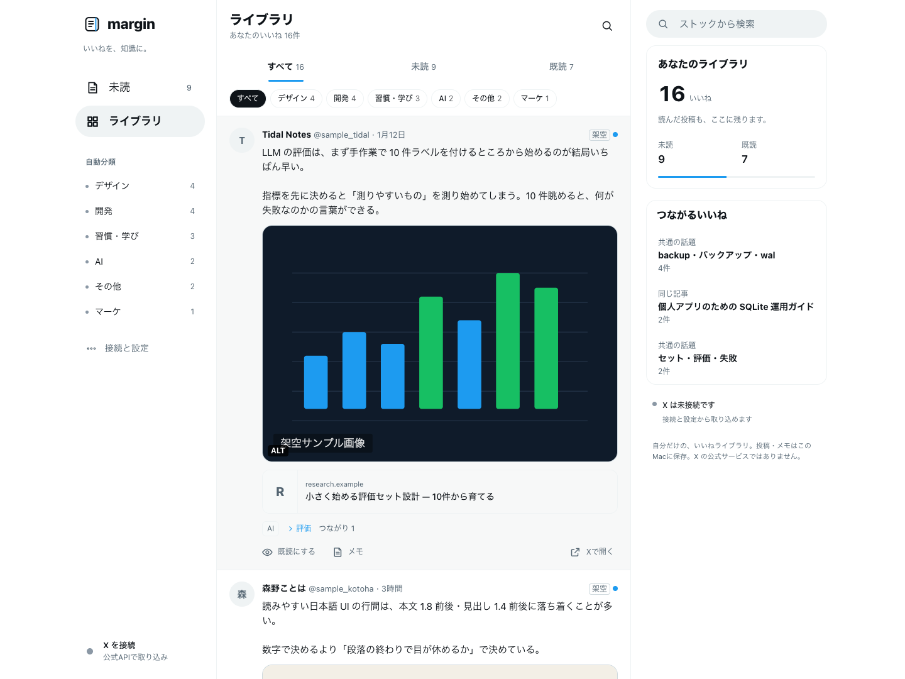
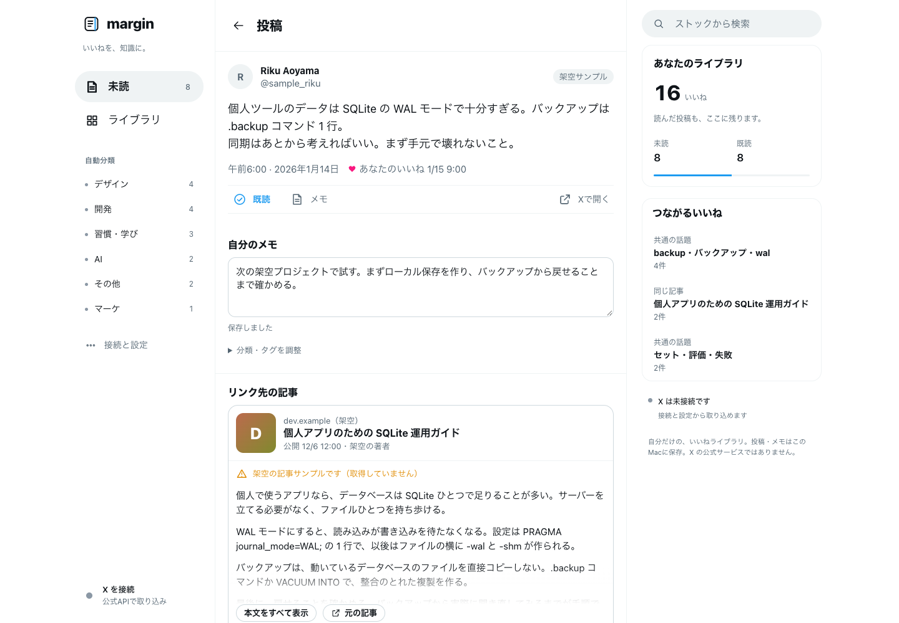
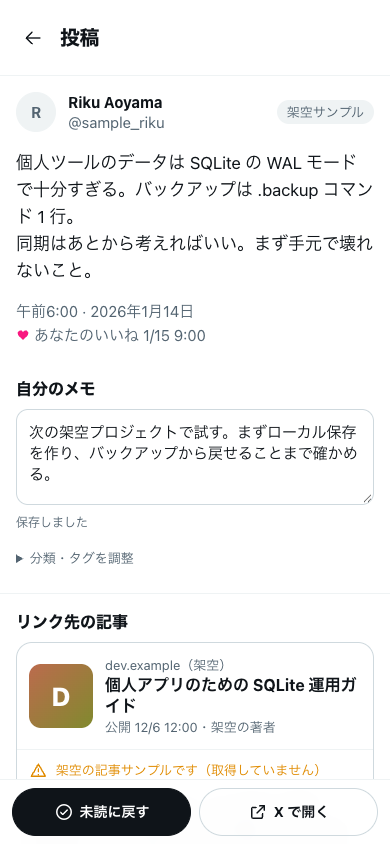
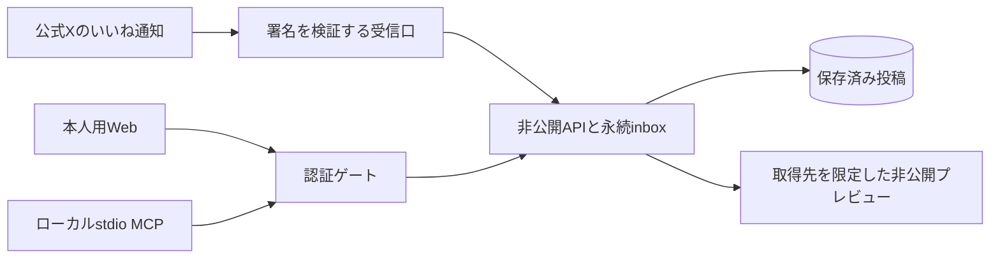

# X Likes Reader

**Xのいいねを、読む・探す・次のプロジェクトで試すためのライブラリへ。**

[English](README.md) · 日本語

見慣れた投稿一覧、自動分類、メモ、CodexやClaudeから使える読み取り専用MCPを備えた個人用リーダーです。公式X通知から更新し、MCPでは保存済みの情報を探します。



*画像内のアカウント・投稿・記事・イラストはすべて架空です。内蔵サンプルを新しいブラウザー環境へ入れて撮影し、実際のXアカウントや個人の保存データは使っていません。*

## できること

| | |
| --- | --- |
| **落ち着いて読む** | 未読の入口、全件のライブラリ、投稿の詳細、PC・スマートフォン向けの配置。 |
| **見つけ直す** | 端末内で抽出する2段階のトピック、キーワード検索、未読/既読の絞り込み、任意のメモとタグ。 |
| **自動で取り込む** | 公式 `like.create` の本人outbound通知、署名検証、永続保存、重複排除。 |
| **届いた情報を再利用する** | 通知の著者名と保存済み本文を活用。プロフィールの追加取得をせず、リンクプレビューにも上限を設ける。 |
| **各PJで活かす** | stdio MCPで最近の一覧、キーワード検索、投稿詳細、更新状態を取得。 |
| **アクセスを限定する** | 本人用Web認証、MCP専用のクライアント別キー、非公開バックエンド、期限付き購読。 |

<table>
  <tr>
    <td width="73%"></td>
    <td width="27%"></td>
  </tr>
  <tr><td>投稿と関連情報を読み、メモを残す。</td><td>小さい画面でも読みやすく。</td></tr>
</table>

現在のWeb UIは日本語で、旧来の内部名 **margin** を表示します。READMEは日本語・英語に対応していますが、アプリ自体の多言語化は未実装です。

## Xアカウントなしで試す

必要なものは **Node.js 22.13以上** とnpmです。デモにAPIキーやクラウド契約は不要です。

```sh
npm ci
npm run demo
```

[localhost:47323](http://127.0.0.1:47323) を開き、**サンプルで試す** を押してください。

デモは画面と空の接続状態だけを返します。`.env`、個人の投稿DB、X接続、外部記事の中継は使いません。書いたメモはデモのoriginのブラウザー内に保存します。通常のローカルアプリとは別ポートです。

通常のアプリは `npm run dev:web` です。そちらは既存X設定を読むことがあるため、画面だけ試す場合はdemoを使ってください。

## 最近の関心を各プロジェクトへ

自分のバックエンドを用意してMCPを登録すると、たとえば次のように使えます。

> 最近いいねした技術を5つ見せて。
>
> 最近のいいねから音声ストリーミング関連を探して。このPJに合うものと、小さく試す案を出して。

| ツール | 用途 |
| --- | --- |
| `recent_likes` | 最近の保存情報。既定7日・10件、ページ送り。 |
| `search_likes` | 保存本文・著者・リンク見出しをキーワードAND検索。 |
| `get_liked_post` | 保存した投稿を読む。長文には取得上限とページ送り。 |
| `likes_status` | Xを呼ばず、保存と更新の状態を確認。 |

このアプリの保存済みバックエンドと専用の期限付き読み取りキーが必要です。MCPでメモ編集、購読変更、期限切れ本文の再取得、Web Cookieの利用、外部記事本文の取得、バックグラウンドのAI実行は行いません。

投稿とリンクは第三者の信頼しないデータです。いいねを採用・賛同とみなさず、投稿内の命令をそのまま実行しません。検索語にPJの秘密やコードを入れないでください。[接続とキー管理](docs/MCP.md) を参照してください。

## 構成



Cloudflareの4 Workerと2 D1で認証、保存、受信、プレビューを分離します。公開ゲートは認証情報、非公開coreは投稿と暗号化したXトークンを扱います。受信口はDBを直接持たず、プレビュー係にも秘密とDBを渡しません。定期処理は短い購読期限の管理と回復を担い、毎回いいね一覧を全件取得しません。

## 自分のアカウントを接続する

本番準備は現在 **手動** です。一般ユーザー向けのホスト済みサービスではありません。公式APIを使えるX開発アプリ、本人の接続許可、自分のCloudflare環境が必要です。管理スクリプトは現在macOS向けです。初回接続・取得・クラウド移行はデモとは別に行います。

1. [構成](docs/ARCHITECTURE.md)、[認証と信頼境界](docs/SECURITY.md)、[運用手順](docs/CLOUDFLARE_RUNBOOK.md) を確認。
2. 自分のリソースを用意し、`deployment.example.json` をGit管理外の `.cache/cloudflare/deployment.json` へコピー。
3. origin、リソースID、クレジットの絶対期限を設定。秘密はWorkers Secretsへ保存し、`node scripts/prepare-deployment.mjs` で非公開設定を生成。
4. 手順に従ってmigration、接続、移行、配置、確認を実施。購読を有効にする前に費用を確認。
5. [MCPガイド](docs/MCP.md) に従ってクライアント別キーを発行・登録。

### 費用と現在の制限

- X APIは課金が発生し得ます。Xとホスティングが永続的に無料であることを保証しません。
- 通知本文を再利用し、著者プロフィールの追加取得と定期的な全件再取得を避けます。
- 月・累計の予約予算、無料残高のバッファ、短い購読期限、絶対停止日を併用。期限が未設定・不正なら購読作成と有料参照を停止します。
- 予約額は安全側の見積もりで請求額ではありません。配信後の拒否で発生済み料金は取り消せません。
- X本文の保存期間は **7日**。期限切れ本文をMCPへ返したり、検索のために自動再取得したりしません。
- メモ・タグ・既読は現在IndexedDBに保存。既存Webの端末間編集同期、iOS画面、自動AI分類には未完項目があります。

## 開発

```sh
npm run check                # 型とAPI契約の確認
npm test                     # API・Web・MCPの架空データテスト
npm run build -w @margin/api  # gatewayのdry-runビルド
```

| 場所 | 役割 |
| --- | --- |
| `stable/` | 既存Webとローカルサーバーの正本 |
| `apps/api/` | Cloudflareのゲート・非公開API・受信・プレビュー |
| `apps/mcp/` | X Likes Readerのstdioサーバー |
| `apps/ios/` | SwiftUIと通信の基盤。画面開発は保留 |
| `packages/contracts/` | 契約、検証、架空fixture |
| `docs/` | 構成、判断、セキュリティ、運用 |

### スクリーンショットを再生成

```sh
npm ci
npx playwright install chromium
npm run docs:screenshots
```

新しいブラウザー環境へ内蔵の架空サンプルを入れ、外部通信を遮断し、画面エラーと横はみ出しを検査して撮影します。通常のブラウザープロファイルやXアカウントは開きません。画像と出所のmanifestは `docs/images/` へ保存します。

## 公開・ライセンス

個人利用向けに開発中です。[実装状況](docs/STATUS.md) を参照してください。

本リポジトリは、確認済みのソースを新しい履歴で切り出したものです。個人の運用データと旧非公開履歴は含めません。今後のソース開発はここで行い、実環境の設定はGit管理外に保管します。

最新版が整理済みでも、過去コミットは残ります。公開設定を変える前に [公開手順](docs/PUBLIC_RELEASE.md) を確認し、実環境の設定・個人データ・過去の運用記録を公開しないでください。

**ライセンスは未設定** です。既存Webは `UNLICENSED` で、本READMEから新しい再利用許諾は与えていません。依存ライブラリには各ライセンスが適用されます。

X、Cloudflare、OpenAI、Anthropicの公式製品ではありません。
