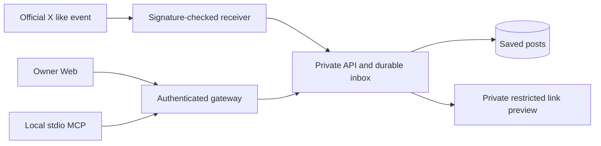

# X Likes Reader

**Turn your X likes into a library you can read, search, and bring into your next project.**

English · [日本語](README.ja.md)

A personal reader with a familiar timeline, automatic topics, notes, and a read-only MCP server for Codex and Claude. Official X notifications update the library; MCP searches saved information without fetching from X again.


*Every account, post, article, and image shown here is fictional. Screenshots use built-in samples in fresh browser contexts, with no real X account or personal saved data.*

## Features

| | |
| --- | --- |
| **Read comfortably** | Unread inbox, full library, focused post view, and responsive desktop/mobile layouts. |
| **Find things again** | Two levels of locally derived topics, keyword search, read/unread filters, optional notes and tags. |
| **Receive new likes** | Official `like.create` outbound notifications, signature verification, durable storage, duplicate handling. |
| **Reuse delivered information** | Author names from notification payloads, cached source text, bounded link previews. No extra author-profile requests. |
| **Use it in your projects** | Read-only stdio MCP: recent items, keyword search, post details, update status. |
| **Limit access** | Owner-only Web access, separate MCP client tokens, private backend services, finite subscription leases. |

<table>
  <tr>
    <td width="73%"></td>
    <td width="27%"></td>
  </tr>
  <tr><td>Read a post, follow its context, and add a note.</td><td>A responsive reading view.</td></tr>
</table>

The Web UI currently uses Japanese labels and the legacy internal wordmark **margin**. Documentation is bilingual; the UI itself is not yet multilingual.

## Try it without an X account

Requirements: **Node.js 22.13+** and npm. The demo needs no API key or cloud account.

```sh
npm ci
npm run demo
```

Open [localhost:47323](http://127.0.0.1:47323) and click **サンプルで試す** (“Try samples”).

The preview serves the UI and empty connection responses only. It does not load `.env` files, open the personal post database, contact X, or proxy external articles. Sample notes stay in this demo origin's browser storage. Its port is separate from the usual local app.

The regular local app is `npm run dev:web`. That app can load existing local X configuration; use `demo` to explore the interface without connecting.

## Bring recent interests into a project

After deploying your own backend and registering an MCP client, ask:

> Show me five technologies I recently liked.
>
> Search my recent likes for audio streaming. Which ideas fit this project, and what is the smallest useful experiment?

| Tool | Purpose |
| --- | --- |
| `recent_likes` | Recent saved posts; defaults to 7 days / 10 items, with pagination. |
| `search_likes` | Keyword AND search across saved text, authors, and link headings. |
| `get_liked_post` | Read one saved post, with bounded text pagination. |
| `likes_status` | Inspect saved-item and update status without calling X. |

MCP needs this application's saved-data backend and a separate expiring read token. It cannot edit notes, change subscriptions, refresh expired posts, or use the owner's Web cookie. It does not fetch external article bodies or run an AI model in the background.

Posts and links are untrusted third-party content. A like is a clue about interest, not an endorsement or an instruction to execute. Keep project secrets and code out of search queries. See [MCP setup and token management](docs/MCP.md).

## Architecture



Four Cloudflare Workers and two D1 databases separate authentication, storage, notification ingestion, and previews. The public gateway holds authentication storage; the private core holds posts and encrypted X tokens. The receiver has no direct database binding, and the preview service has no secrets or database. A scheduled job manages short subscription leases and recovery rather than repeatedly downloading the entire likes list.

## Connect your own account

Cloud deployment is currently **manual**, intended for personal use rather than a hosted multi-user service. You need an X developer application with suitable official API access, an authorized account, and your own Cloudflare environment. Administrative scripts currently target macOS. Initial connection/import and cloud migration are separate from the demo.

1. Read the [architecture](docs/ARCHITECTURE.md), [security boundaries](docs/SECURITY.md), and [deployment runbook](docs/CLOUDFLARE_RUNBOOK.md).
2. Create your resources and copy `deployment.example.json` to the ignored `.cache/cloudflare/deployment.json`.
3. Set your origins, resource IDs, and absolute credit deadline. Store secrets in Workers Secrets. Generate private configs with `node scripts/prepare-deployment.mjs`.
4. Follow the runbook for migrations, authorization, data migration, deployment, and verification. Review costs before enabling subscriptions.
5. Issue a client-specific read token and register MCP using the [MCP guide](docs/MCP.md).

### Costs and current limits

- X API usage may be billed. This project does **not** promise free X access or permanent free hosting.
- Notification content is reused. Extra author-profile requests and periodic full-library polling are avoided.
- Conservative safeguards include monthly/lifetime reservation caps, a free-credit buffer, short subscription leases, and an absolute stop date. Missing or invalid deadlines stop subscription creation and paid lookups.
- Reservations are estimates, not provider invoices. A delivered notification may already have incurred a charge.
- Saved X source text has a **7-day retention window**. Expired text is not returned by MCP or automatically re-fetched for search.
- Notes, tags, and read state currently stay in IndexedDB. Cross-device editing sync is not connected yet. iOS screens and automatic AI classification are unfinished.

## Development

```sh
npm run check                # TypeScript and API contract checks
npm test                     # Fictional-data API, Web, and MCP tests
npm run build -w @margin/api  # Gateway dry-run build
```

| Directory | Responsibility |
| --- | --- |
| `stable/` | Canonical Web UI and local server |
| `apps/api/` | Cloudflare gateway, private API, receiver, preview |
| `apps/mcp/` | X Likes Reader stdio server |
| `apps/ios/` | SwiftUI/client foundation; UI work is paused |
| `packages/contracts/` | API contracts, validation, fictional fixtures |
| `docs/` | Architecture, decisions, security, operations |

### Recreate the screenshots

```sh
npm ci
npx playwright install chromium
npm run docs:screenshots
```

The capture script inserts built-in samples into fresh browser contexts, blocks external browser requests, and checks for page errors and horizontal overflow. It never opens your normal browser profile or X account. Images and their provenance manifest are in `docs/images/`.

## Publication and license

This is a personal-use project in active development. See [implementation status](docs/STATUS.md). Supporting technical guides are currently in Japanese.

This source repository starts from a reviewed snapshot with a new history. Personal deployment data and private development history are excluded. Continue source development here and keep deployment configuration outside Git.

A clean current tree does not remove older commits. Review the [public-release checklist](docs/PUBLIC_RELEASE.md) before changing repository visibility. Private deployment settings, personal data, and historical operational records must stay out of a public release.

**No open-source license has been assigned.** The existing Web package is marked `UNLICENSED`; this README does not grant a new reuse license. Third-party dependencies retain their own licenses.

Not affiliated with X, Cloudflare, OpenAI, or Anthropic.
