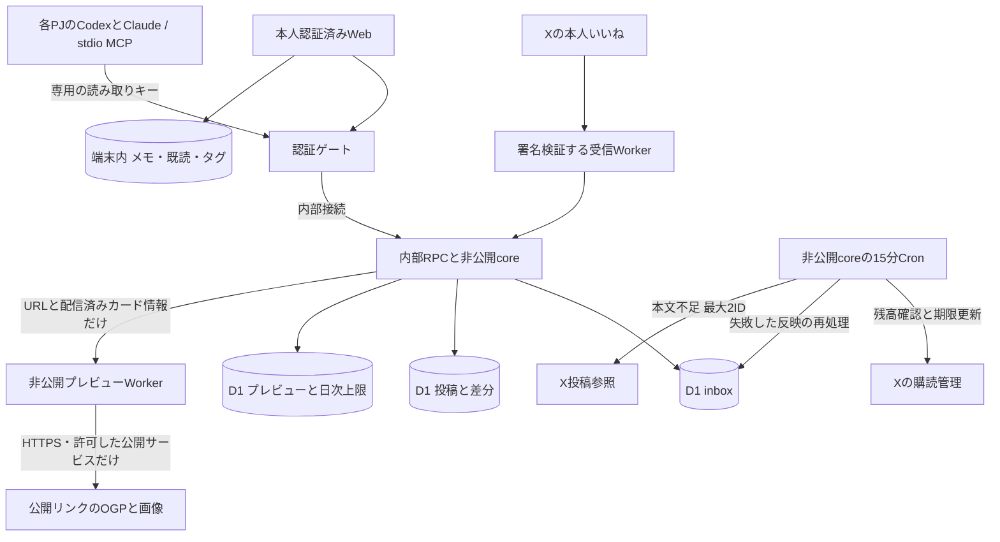

# margin の構成

更新: 2026-10-17。実装状態は [STATUS.md](STATUS.md)、運用は [CLOUDFLARE_RUNBOOK.md](CLOUDFLARE_RUNBOOK.md)、判断履歴は [DECISIONS.md](DECISIONS.md)。

## 現在の経路

本人専用WebをCloudflare Workers FreeとD1へ置いた。Xで本人がいいねすると、公式Activity APIの `like.create` / outboundが独立受信Workerへ届く。HMAC署名と本人actorを確認してから最小本文をD1 inboxへ永続保存し、内部Service Binding/RPCで共通投稿・差分へ反映する。保存完了後にACK。署名不正・DB障害は成功としない。

受信WorkerはCRCとPOSTだけを公開し、D1を直接持たない。署名付き原文を内部RPCで非公開のmargin-coreへ渡し、そこで署名を再確認・永続保存する。margin-coreはworkers.dev/previewとも無効。公開Webのmargin-apiは認証専用D1だけを持ち、本人リンクのセッション確認後に画面と内部APIを返す。公開Webに投稿DBとX秘密を置かない。[認証・権限の詳細](SECURITY.md)

通知本文があればXで取り直さない。通知のincludes.usersで投稿author_idと一致する表示名・usernameだけ利用する。プロフィール詳細・引用・メディアの追加取得はしない。本文不足は有効な既存sourceを使い、不明ならpending。必要なIDだけ予算と残高確認の下で参照する。直近いいねの定期照合・Replayは未実装で、保存済み一覧の定期再取得は行わない。

本人のiOS作り込み保留を維持する。将来はSwiftUIとWebが共通API/保存/同期を使う。現在の実投稿経路はCloudflareで、旧Mac Nodeの取得係は停止済み。

## 保存と同期

本人用MCPはapps/mcp/のstdioから限定 `/mcp-read/recent|search|post|status` を呼ぶ。Web Cookieと別の30日期限・クライアント別read tokenをAUTH_DBでhash照合し、gateway/coreで両方検証。読み取り4経路以外のowner/API/購読操作を許可しない。D1の保存済みsourceだけを上限付きで返し、TTL7日と本人編集の分離を維持する。初期化やtools/listはデータ通信なし。追加のX参照・外部AI API・ホスティングなし。[MCP運用](MCP.md)

X投稿IDは文字列。sourceと本人userを分け、取得時に本人編集を初期化しない。最大20件のinbox処理、投稿更新と処理済み記録を同じD1トランザクションにする。UUIDの再送と順不同の古い通知ではrevisionを進めない。いいね日時はmetadata.likedAtで投稿日時と分ける。

書き込みと差分履歴を同じトランザクションに置き、単調cursorで同期する。本人編集APIはexpectedRevisionによるSQL比較更新、競合は409と現在値。削除はsource=nullを配信し、履歴・未処理inboxの本文も除去する。本文は7日、処理済みinbox本文は即時消去、UUIDは30日。API読み出しでも期限を確認する。

**既存Webの本人編集はまだIndexedDBが正本。** `/api/x/items` の互換APIでsourceだけを反映し、端末のメモ・既読・タグを保護する。表示中15秒の差分確認と手動更新はD1だけを読む。全件数の集計を伴う接続状態は1分に1回、明示操作後だけ即時更新する。現在のページではcursor以降を取得し、次のページ起動時はD1の差分を最初から読み直す。X取得は増えないが、将来は端末cursorの永続化と履歴圧縮でD1量をさらに削減する。

共通 `/v1` 本人編集・同期APIとSwiftの下書き/競合保全は実装済みだが、既存Webの編集送信と実データiOS接続は未配線。複数端末でメモが同期する段階ではない。ローカルoriginからクラウドoriginへの個人編集はJSONバックアップの確認付き復元で引き継ぐ。既に編集した移行先投稿は上書きせず、確認後の編集競合は反映を中止して保全する。

## 本人認証と秘密

本人リンク方式では、Mac管理CLIだけが256-bitの24時間・1回限定許可を発行。fragmentは読み込み時に消し、同一Origin/CSRF付きPOSTとD1の原子的消費で別の30日Cookieへ交換する。CookieはSecure/HttpOnly/SameSite=Strictでhashだけ保存。この端末/全端末を失効できる。一般登録・公開再発行・パスワード・Bearer/Access・旧90日接続はなし。リンクを知った人も本人と同じアクセスができるので秘密として扱う。

パスキー実装は架空テスト付きで保持するが、本人指示で保留し本番リンク方式ではパスキー経路を無効にする。Cloudflare Accessの有料契約は行わない。iOSの本番認証は未接続。

Xの固定秘密はWorkers Secrets。OAuth更新トークンはAES-256-GCMでD1へ暗号化保存し、秘密・本人投稿・メモ・ログインリンクをGitやログに出さない。refreshはD1永続ロック下で1回だけ実施。結果不明はrefreshUncertainとして停止し、消費済みかもしれない更新トークンを無条件に再利用しない。

## 購読・取得・費用

X購読は1時間lease。15分Cronが予算と無料残高を確認し、残り30分以下で自アプリの購読を解除、一覧消失を確認後に新規作成。PUTによる未記載の期限変更を使わない。作成は事前に不確実状態を保存し、次回はtag・Webhook・本人・outbound・期限を確認して引き継ぐ。異なる条件なら解除・停止。他アプリの購読は操作しない。

受信UUIDごとに$0.01を暫定予約。重複UUIDは予約を増やさない。実単価ではない。通常UTC月$1・累計$8と個別設定control.freeStopAtによる絶対停止を併用（未設定・不正は停止）。無料残高$1以下、基準残高から$1以上の減少、認証障害でも停止。確認不能なら更新せず短いX側期限で失効する。X側のサイクル上限と自動チャージオフを併用するが、通知配信への厳密適用と精密単価は未確定。配信後の拒否や解除は既に発生した料金を取り消せない。

投稿参照は1IDだけ、6日以内のcacheを優先、同じIDを24時間に1回、取得前に$0.005予約。失敗しても予約・試行を保持。Cronの本文不足取得は最大2件。プロフィールは呼ばない。自由な全件再同期・バックフィルをクラウドUIへ置かない。

CloudflareはFreeのまま。無料枠が超過しても有料へ自動アップグレードしない。FreeのCPU上限は10ms、呼び出し上限は10万/日。索引・差分100件・1回20inboxで量を制限する。料金や無料条件の将来変更は保証できないため、実行状態と費用は管理画面・statusで確認する。[公式Workers上限](https://developers.cloudflare.com/workers/platform/limits/)

## WebとiOS

Webは「未読」「ライブラリ」、Xに近い白黒・青と投稿表現。あとで・残すは使わず、既読でもライブラリに残る。大分類と端末内で動的に抽出する具体トピックの2段階。製品名の固定カテゴリや外部AIは使わない。メモ・タグを分類で書き換えない。意味的な別名統合は未実装。[DESIGN_SYSTEM.md](DESIGN_SYSTEM.md)

SwiftUIはiPhone向け、CoreはFoundation/URLSession/Keychain・原子的cache・下書き・競合保全。SwiftData/iCloudは未導入。画面の作り込みは保留。実機配布の条件は別途確認する。

## 保全と制限

正本: stable/（Web）、apps/api/、apps/ios/、packages/contracts/。履歴・原成果はarchive等へ残し、再適用しない。元のMac SQLite、IndexedDB、JSON/SQLiteバックアップを保全する。秘密・実データ・生成物はGit対象外。

Nodeの記事取得はDNS/IP固定等を持つがWorkersへそのまま移植しない。クラウドの全文記事・任意URL画像取得は未実装。リンクカード専用のOGPと画像中継を下記の制限で追加した。

## 著者名とリンクカード（2026-10-13）

著者名は配信済みデータのみ。未取得の過去投稿を名前のためにバックフィルしない。URLエンティティのtitle/description/画像URLを保持し、投稿本文・本人編集の保存方式は維持する。

表示に入ったX API由来カードだけ `/api/link-preview` を呼ぶ。同時2件、端末内URL単位キャッシュ、サーバーでURLのSHA-256をキーに重複実行を抑える。投稿D1に保存済み・7日以内のsourceに属するURL以外は取得不可。成功は最大7日（source期限以内）、失敗は24時間、UTC日次60回まで。D1条件付きUPSERTで原子的に確保し、失敗も1回に数える。期限切れcacheは15分Cronで削除する。

coreのPREVIEW Service Bindingでmargin-previewへURLと配信済みカード情報だけ送る。margin-previewに公開URL・DB・秘密・Cron・VPC接続を持たせない。標準HTTPSを使い、GitHub/note/Qiita/Zenn/Python等、コードに明示した公開サービスのDNS名前空間だけ許可。任意の個人サイトは文字カード。DNSのA/AAAAを全件検査し、リダイレクトも最大3回・毎回再検査。Workersでは検証済みIP固定のhostname TLSを保証できないため、接続先IPの固定は主張せず、許可サービスのDNS管理と標準TLSを信頼境界にする。

配信済みの見出し＋画像URLがあればHTML再取得を省く。不足時はOGPのみ抽出。Cookie・Authorization・RefererやX本文・メモを外へ送らない。上限はHTML/画像それぞれ256KiB、全体10秒、画像はPNG/JPEG/WebPのMIMEとmagicが一致するものだけ。SVG・HTML・GIFを画像として配信しない。カード画像は本人認証付き同一Origin APIからBlobにし、ブラウザは外部画像ホストへ接続しない。

画面は大きな画像・見出し・説明・ドメインのカード。取得できなければ文字カードを維持する。外部HTMLやscriptは実行せず、文字列はtextContentに入れる。Xのカードキャッシュや選択とは完全一致を保証しない。追加X Read・外部AI・有料サービスは導入しない。
